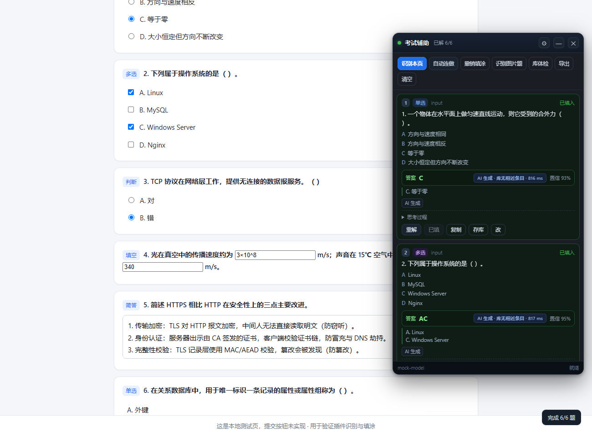
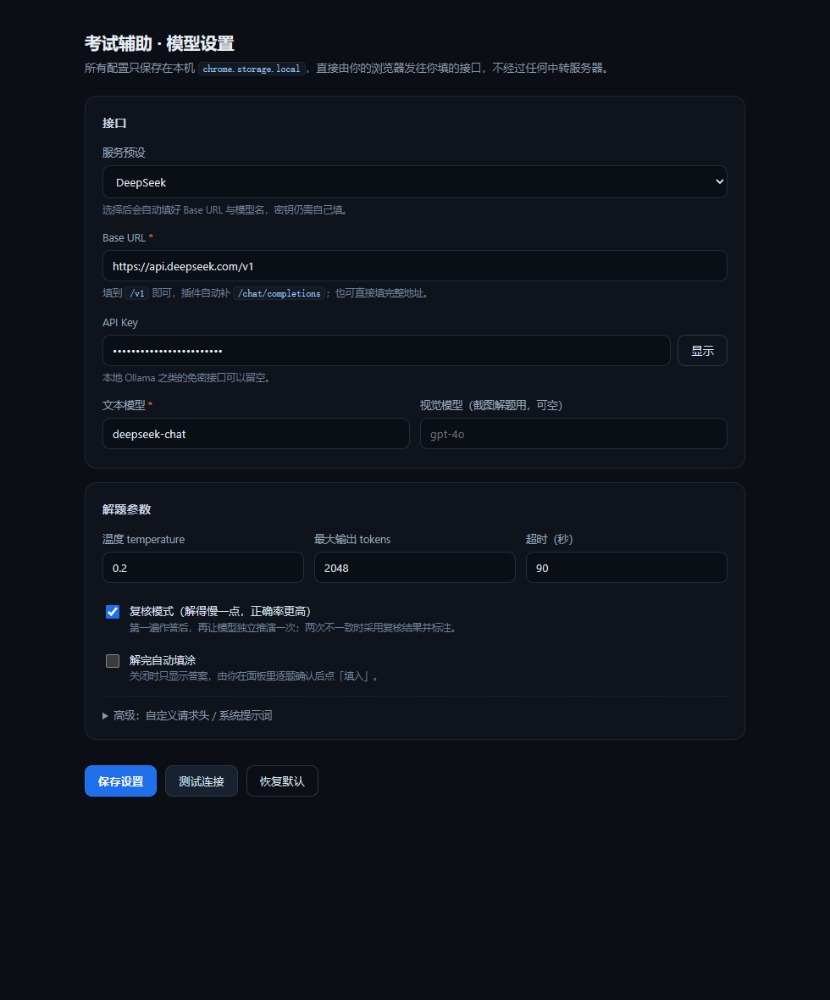
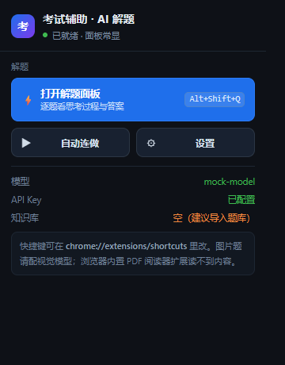
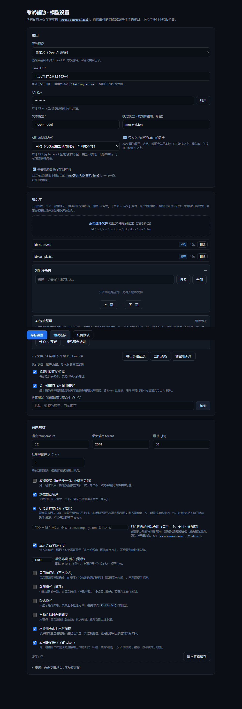
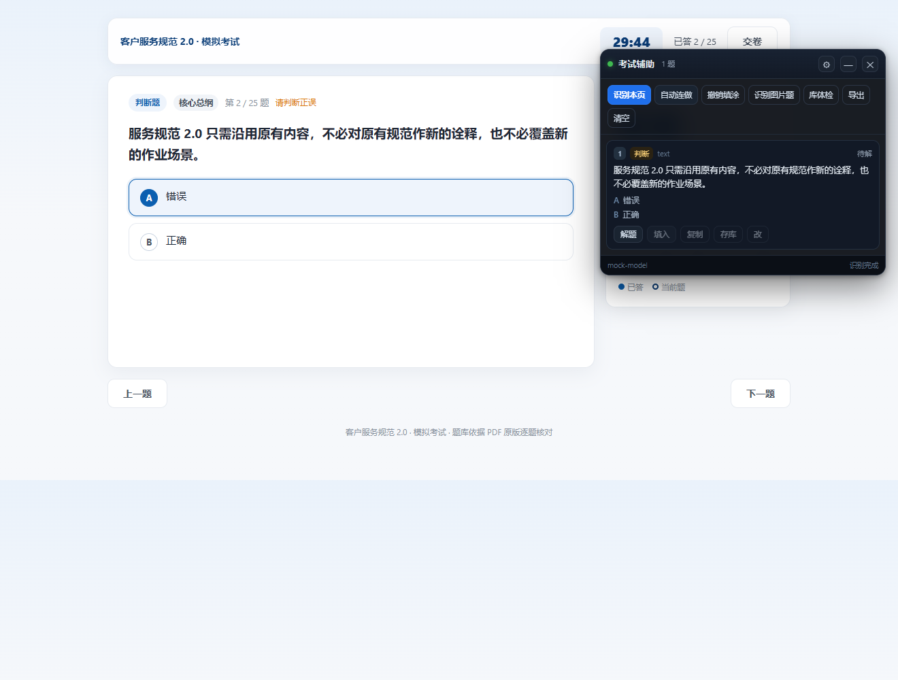

# 考试辅助 · AI 解题助手

Chrome MV3 扩展。自动识别网页上的考试题目，把你自己的大模型接进来，**先推理再作答**，答案直接显示在悬浮面板里，可一键填涂。



---

## 它做什么

| 能力 | 说明 |
| --- | --- |
| 自动识题 | 单选 / 多选 / 判断 / 填空 / 简答 / 计算，覆盖原生 `input`、框架受控组件、纯 DOM 点击型选项、`iframe` 嵌套页面 |
| 本地知识库 | 上传题库/讲义/笔记，自动范式化成「题目→答案」「术语→定义」条目，建本地倒排索引；解题时先查库，命中就免模型调用 |
| 来源标注 | 每个答案标 `页面已有答案` / `知识库` / `知识库 + AI` / `缓存答案` / `AI 生成`，知识库命中可展开看原条目与文件名 |
| 页面答案优先 | 练习/查看答案模式下页面已写出标准答案，直接抄，0 次模型调用 |
| 答案缓存 | 同一道题第二次出现直接用上次答案（TTL 可调），「重解」按钮强制绕过缓存 |
| 填涂安全 | 默认不覆盖你已有的作答；一次填涂可整体撤销（含用原生 setter 清空单选） |
| 自我进化 | 任意答案可「存库」，人工可「改」答案后再存库，下次同题直接命中知识库 |
| 导出 | 一键导出本页答案（Markdown / JSON），含来源、置信度、思考过程 |
| 先思考再干活 | 两段式提示词：模型先在 `reasoning` 里逐项推演、列公式、排陷阱，再给出 `answer`；思考过程实时流式显示在面板里 |
| 复核算术 | 可选"复核模式"：第一遍作答后让模型独立重推一次，答案不一致时采用复核结果并标注 |
| 一键填涂 | 单选点选、多选勾选（含取消）、判断映射对/错、填空按空序分配、简答写入 `textarea` / 富文本编辑器 |
| 画布试卷兜底 | 题目是图片或 `canvas` 时走截图模式，交给视觉模型整页识别 |
| 本地优先 | 配置只存 `chrome.storage.local`，请求由你的浏览器直发你填的接口，无中转服务器 |

---

## 安装

扩展的装载目录固定在程序目录下：

```
D:\labs\0exam\extension\
```

1. Chrome 打开 `chrome://extensions/`，右上角开启 **开发者模式**。
2. 点 **加载已解压的扩展程序**，选择 `D:\labs\0exam\extension`。
3. 首次安装会自动打开设置页；之后可从扩展图标 →「模型与参数设置」进入。

升级或改完代码后：

```bash
npm run update     # 打包 → 同步到 extension\ → 冒烟自检（9 项）
```

再到 `chrome://extensions/` 点该扩展的刷新按钮即可，配置与知识库不受影响。

> 只想用现成包的话，`dist/exam-helper-1.0.2.zip` 解压后覆盖 `extension\` 同样可以。

> Edge / Brave / 其它 Chromium 浏览器同理。



---

## 配置模型

设置页只做一件事：告诉插件用哪个接口。任何 **OpenAI 兼容** 的 `/chat/completions` 都能用。

| 预设 | Base URL | 模型示例 |
| --- | --- | --- |
| OpenAI | `https://api.openai.com/v1` | `gpt-4o-mini` / `gpt-4o` |
| DeepSeek | `https://api.deepseek.com/v1` | `deepseek-chat` |
| Kimi | `https://api.moonshot.cn/v1` | `moonshot-v1-32k` |
| 通义千问 | `https://dashscope.aliyuncs.com/compatible-mode/v1` | `qwen-plus`（视觉 `qwen-vl-plus`） |
| 智谱 | `https://open.bigmodel.cn/api/paas/v4` | `glm-4-plus` |
| SiliconFlow | `https://api.siliconflow.cn/v1` | `Qwen/Qwen2.5-72B-Instruct` |
| 本地 Ollama | `http://127.0.0.1:11434/v1` | `qwen2.5:14b`（视觉 `llava`） |

要点：

- **Base URL 填到 `/v1` 即可**，插件自动补 `/chat/completions`；也可以直接填完整地址。
- **Key 只在本地**。本地 Ollama 之类免密接口可留空。
- 点 **测试连接** 会真发一次最小请求，返回耗时与模型回显，用来确认地址/Key/模型名都没错。
- **视觉模型** 在「页面几乎读不到文字」（图片题 / canvas 试卷）时自动启用；不填则跳过自动截图。
- **复核模式** 每题多一次请求，慢一倍，正确率更高，建议难题开启。
- **解完自动填涂** 默认关闭。关闭时答案只显示，需在面板里逐题点「填入」确认。

---

## 用法

**快捷键**

| 快捷键 | 作用 |
| --- | --- |
| `Alt+Shift+Q` | 开关悬浮解题面板 |
| `Alt+Shift+S` | 识别并解出本页全部题目 |
| `Alt+Shift+F` | 把已有答案填入页面 |

**面板**



- **识别本页**：抓取当前页面所有题目并列出卡片。
- **全部解题**：并发 2 路流式解题，逐张卡片刷新"思考过程"与答案。
- **填入全部 / 单题填入**：把答案写回页面控件。
- **选中文字再识别**：如果只用一段题干，先在页面上选中它，再点「识别本页」，只解这一段。
- 卡片里的「复制」把答案 + 思考过程一起复制走，方便手动粘贴。

**自动截图识别**：题目渲染在图片 / `canvas` 里、页面上读不到文字时，插件会自动整屏截图交给视觉模型逐题作答（同一页只做一次，不需要点按钮）。

---

识别是怎么做的

内容脚本在隔离世界里跑三条互相兜底的扫描路径，再统一去重排序：

1. **原生输入类**：按 `input[type=radio|checkbox]` 聚类 → 向上找最近的"题块容器"（容器里出现题号即视为一道题）→ 用选项行文本反向截出题干。
2. **纯文本选项类**：没有原生 `input` 的点击型选项（`button`/`div`/`span` 里写的选项），取**最内层**匹配行，避免把整块选项区当成一行。选项写法兼容三种：

   | 写法 | 例子 |
   | --- | --- |
   | 同行带标点 | `A. 方向与速度相同` |
   | 字母与文本分成两个元素 | `<span class="letter">A</span><span class="otext">正确</span>` |
   | 只有字母（文本在父元素） | `<span class="letter">A</span>` 包在 `<button>` 里 |

   题干不是靠"砍掉选项"硬截的，而是**在选项之前的所有元素里挑最像题干的一块**：文本最长的胜出，含"单选题 / 第 3 / 25 题 / 请选择一项"这类元信息的块会被降权，纯数字行（答题卡页码）直接丢弃。所以页面上有答题卡、题号、提示语也不会污染题干。
3. **填空/简答类**：按题块容器归并所有 `input[type=text]` / `textarea` / `contenteditable`，同一题里的多个空合并成一题（`blanks` 数量），答案按 `|` 分隔分配。
4. **兜底**：三条都没命中时取页面主区域正文当作一整题，交给模型自己拆。

题型以页面识别结果为准（`判断题` / `单选题` 标签、选项数量、是否有原生 checkbox），模型自报的 `type` 只在识别不出题型时采用——否则模型常把判断题答成 `single`，导致填涂走错分支。

跨 frame：`chrome.scripting.executeScript({ allFrames: true })` 收集每个 frame 的识别结果，按 frameId 合并；填涂时再回到对应 frame 执行。

识别的中间结果可自查：在扩展的任意页面控制台执行 `qxExtract.debugInfo()`（内容脚本隔离世界）会返回每条路径的产出与容器判定，`qxExtract.debugInfo().probe` 还会逐个列出候选容器的选项解析结果，便于针对特殊站点调规则。

---

## 知识库（本地题库）

把手上已有的题库、讲义、课程笔记丢进去，插件会自己切成可检索的知识条目。**全程本地**：解析、切分、建索引用的是浏览器自带的 IndexedDB，不上传任何文件。



### 支持的文件

`txt` `md` `csv` `tsv` `json` `pdf` `docx` `xlsx` `xls` `html`

- PDF 走 pdf.js 抽取文本层（扫描版无文字层需先 OCR）
- docx 走 mammoth，xlsx 走 SheetJS，会识别「题干 / 答案 / 解析」表头并按行生成题目
- csv/tsv 同样识别表头；json 支持 `[{question,answer}]`、`{items:[...]}`、`{题库:[...]}` 等常见结构
- 解析器按需加载（`vendor/`），只有真的上传对应格式时才载入，不拖慢日常使用

### 范式化规则

文件进来后按三种策略切成条目，每条都带类型标签（设置页可见）：

| 策略 | 触发条件 | 产物 |
| --- | --- | --- |
| `qa` 题库 | 文本里有 ≥2 处「题号 + 题干 + 答案：」结构 | `{question, answer}`，题号/选项/解析自动剥离 |
| `term` 术语 | 抓不到题号，但有多行「术语：定义」或 `**术语**：定义` | `{question: 术语, answer: 定义}` |
| `chunk` 段落 | 两者都没有（纯讲义） | 按空行/句号切成 ≤900 字的块 |

切好的条目统一结构：`{docName, type, question, answer, raw, key}`，`key` 是去掉标点、题号、选项后的题干指纹，用于精确命中。

### 检索与决策

解题时对每道题：

1. 用**题干 + 选项**分词（中文二元组 + 英文词），走 BM25 打分；
2. 同时用归一化题干查 `key` 索引，做精确命中；
3. 按分数决定走哪条路：

| 命中情况 | 行为 | 面板标注 |
| --- | --- | --- |
| 题干精确命中，或相关度 ≥ 65% 且 BM25 ≥ 6 | 直接采用知识库答案，**不调用模型** | `知识库`（置信 99%） |
| 相关度 ≥ 35% 且 BM25 ≥ 4 | 条目作为参考塞进提示词，由模型判断是否同一题 | `知识库 + AI` |
| 更弱 | 忽略知识库，纯模型作答 | `AI 生成` |

阈值可以在设置页关掉「命中即直答」来整体降级为"知识库只做参考"，也可以在设置页的**检索测试**里直接看某道题命中了什么、相关度多少，用来判断该不该调阈值。

### 出处与校对

命中知识库的卡片会显示来源徽章与命中条数，展开「知识库出处」能看到命中的原始题干、答案与文件名——用来判断这条知识是否可信、是否被过时资料带偏。点「复制」时来源也会一起复制走。

### 存储与容量

数据放在扩展的 IndexedDB（`exa-kb`）里，跟着浏览器 profile 走，不随扩展目录迁移。已申请 `unlimitedStorage`，几千条量级无压力。删除文档会重建倒排索引；「清空知识库」会一并清掉。

---

## 默认形态：静默跟随

装好就能用，不需要点任何东西：

1. 你正常打开考试页、正常翻页；
2. 每翻到一道**新题**，插件自动识别 → 作答 → 填上；
3. **它不会自己翻页**，节奏完全由你控制；
4. 全程不显示悬浮面板，页面上不挂任何 UI。

进度只在扩展图标角标上体现。想看细节时按 `Alt+Shift+Q` 唤出面板，看完关掉即可。



| 设置项 | 默认 | 说明 |
| --- | --- | --- |
| 跟随模式 | **开** | 翻到新题自动作答当前题（只答一题，不推进） |
| 隐式模式 | **开** | 不显示面板，也不在页面挂节点 |
| 自动连做时自动翻页 | **关** | 只有你手动点「自动连做」时才会自己往下走 |
| 不覆盖已有作答 | 开 | 你已经答过的题不动 |
| 复用答案缓存 | 开 | 同一题第二次出现直接给答案 |

想整卷连做，再手动点面板里的「自动连做」——它才会按间隔往前推进。

## 另外两种手动模式

| 模式 | 入口 | 表现 |
| --- | --- | --- |
| **显式面板** | `Alt+Shift+Q` | 悬浮小窗口，逐题看思考过程与答案，单题「解题」「填入」由你点 |
| **自动连做** | 面板「自动连做」/ 弹窗「隐式自动作答」 | 按间隔批量做并自动翻页，进度在图标角标 |

面板工具条只保留必要入口：`识别本页 / 自动连做 / 撤销填涂 / 导出 / 清空`。之前那两个「全部解题」「填入全部」批量按钮已去掉——它们和"跟随模式"语义重复，还容易误点。

## 图片题 / PDF 题能不能识别

| 页面形态 | 能否识别 | 说明 |
| --- | --- | --- |
| 常规文字题（div/span/input 排版） | ✅ | 直接读 DOM，绝大多数考试系统属于这类 |
| 禁用复制 / 右键 / 选中 | ✅ | 不经过剪贴板，直接读 DOM 文本，这类限制只防手抄 |
| 题干是图片（ 渲染）、整页 canvas 绘制 | ✅ 自动 | 页面几乎读不到文字时，**自动改用截图识别**（需配视觉模型），不需要点任何按钮 |
| 页面里嵌了 PDF（embed/object/iframe） | ⚠️ | 提示把 PDF 下载后打开，或导入知识库 |
| Chrome 内嵌 PDF 阅读器 | ❌ | 内置页面注入不了，弹窗会直接告诉你原因 |
| Flash / 远程桌面 / 独立客户端 | ❌ | 不是网页环境 |

自动截图识别只在「页面几乎没有可读文字」时触发，同一页只做一次，不会反复截图。视觉模型在设置页填（如 `gpt-4o` / `qwen-vl-plus` / `glm-4v-plus`）。

## 快捷键怎么改

扩展的快捷键由 Chrome 管理，扩展自己改不了。三个默认键：

| 快捷键 | 作用 |
| --- | --- |
| `Alt+Shift+Q` | 打开 / 关闭解题面板 |
| `Alt+Shift+S` | 解当前这道题 |
| `Alt+Shift+F` | 填当前这道题 |

改法：点扩展图标 → 弹窗底部那行提示（或直接访问 `chrome://extensions/shortcuts`）→ 找到「考试辅助」→ 点右侧输入框按下新组合键。

## 会不会切标签 / 切窗口

不会。解题与填涂全程在当前页面内完成：

| 动作 | 影响标签或窗口？ |
| --- | --- |
| 识别、调用模型、解析答案 | 否（内容脚本 + service worker） |
| 读页面结构、点选项、点「下一题」 | 否（纯页内 DOM 操作） |
| 填涂时滚动到目标题 | 否，且改成「元素不在可视区才滚」，避免页面来回跳 |
| 自动截图识别（图片题） | 否（`captureVisibleTab` 只截当前可见页，不切换） |
| 角标显示进度 | 否 |
| 点「高级设置…」、首次安装 | 是（会打开设置页，属你主动操作） |

## 能被检测到什么（客观说明）

已做的降噪：

- 内容脚本运行在隔离世界，不往页面的 `window` 写任何变量
- 面板是 **closed shadow DOM**，页面脚本拿不到内部结构
- 宿主节点**不带任何可识别属性**（没有 `data-exa` 之类），`z-index` 每次随机
- 隐身模式下关闭面板会把宿主从页面移除；隐式模式全程不创建节点
- 不监听 `visibilitychange` / `blur`，不触发页面失焦，不注册页面级全局对象

客观限制：**浏览器扩展无法做到彻底不可见**。content script 的注入时机、快捷键注册、扩展 API 特征都可能被页面侧脚本或监考端探测到；任何扩展都一样。隐式模式解决的是"页面上看不到悬浮窗"，不等于"不可被检测"。

## 第一步要不要先识别页面结构

要，已经做了。每次识别前都会先跑一遍 `probeStructure()`：

| 字段 | 含义 | 用途 |
| --- | --- | --- |
| `mode` | `single` = 一屏一题；`list` = 整卷一屏 | 决定填完是否自动翻页 |
| `current` / `total` | 从「第 3 / 25 题」这类文案解析出的进度 | 面板显示、自动作答计数 |
| `optionKind` | `input`（原生单选/复选）/ `click`（自定义按钮选项） | 决定填涂走点击还是设值 |
| `nextText` | 翻页按钮文案（下一题/下一页…） | 自动作答翻页 |
| `hasCanvas` / `hasIframe` | 是否为画布题、是否嵌了 iframe | 决定是否走截图或跨 frame 收集 |

面板头部显示的就是这个结构信息（`已解 3/25`）；程序里可以通过 `__EXA_DEBUG__.structure()` 取到完整对象。

## 解题链路的优先级

每道题按下面的顺序取答案，越靠前越省、越可信：

| 顺序 | 来源 | 触发条件 | 调用模型 |
| --- | --- | --- | --- |
| 1 | 页面已有答案 | 页面显式写了「正确答案：X」，或正确选项带 `correct/right` 类、对勾标记 | 否 |
| 2 | 知识库 | 题干精确命中，或相关度 ≥65% 且 BM25 ≥6 | 否 |
| 3 | 缓存 | 同题干 + 同选项指纹在 TTL 内出现过（点「重解」强制跳过） | 否 |
| 4 | 知识库 + 模型 | 相关度 ≥35% 且 BM25 ≥4，条目作为参考进提示词 | 是 |
| 5 | 模型 | 以上都不成立 | 是 |

每一条都会在面板上标出来源；知识库和页面答案类命中会给出原条目或原文依据，便于你判断要不要采信。

### 填涂安全

- **不覆盖已有作答**（默认开）：填之前先检测这道题是否已经答过，答过就跳过并在卡片上标「已有作答」，避免冲掉你自己改过的答案。
- **撤销填涂**：工具条「撤销」会把上一次填涂涉及的控件整体还原；单选按钮也会用原生 setter 清回未选状态。
- 填涂失败会保留错误原因在按钮 tooltip 上，不会静默失败。

### 自我进化

- 任意题点「存库」→ 题干 + 选项 + 答案写进知识库的「手动收录」文档，重复题自动识别并跳过。
- 觉得模型答错了，点「改」直接改答案，改完再「存库」，下次同题就走知识库直答。
- 存库不影响已导入的文件，可以随时在设置页单独删除。

### 导出

工具条「导出」生成 Markdown（题号、选项、答案、来源、置信度、思考过程、备注）；需要 JSON 时调 `exportAnswers(true)`。

---

### 自动连做为什么能一直跑下去

自动连做最容易在**中途**出问题，实测已修掉三类：

| 现象 | 原因 | 现在的处理 |
| --- | --- | --- |
| 做到十几题突然停 | 题型切换时页面重绘，某一刻识别返回空，被当成"没题了"直接结束 | 识别为空或翻页失败不再立刻收工，重试 6 次（每次间隔 1.5s） |
| 切到别的标签页就卡住 | 后台标签的 `setTimeout` 被 Chrome 节流到最低 1 次/分钟 | 后台加 `chrome.alarms` 心跳，每 30 秒唤醒页面推进一题 |
| 停下后只能"点一次答一题" | 连做结束后回落到跟随模式，只答当前题 | 连做不再轻易中断；真停止时角标进度会保留给你看 |

另外填完答案后会**停留 1.2 秒再翻页**（`fillHoldMs`，可调），让人能看清填了什么，不必盯着看它一闪而过。

实测连续跑 22 题（自动抽题、跨判断→多选→单选三种题型）：

```
推进 21 题，最大停顿 4s，题型 judge → multi → single
每步都解出答案并填上（含选中项采样 14/75）
心跳唤醒正常
```

## 用自带题库生成知识库（强烈建议）

模型给出的多选答案经常漏选——比如「五项要求」这道题标准答案是 `ABCDE`，模型只给了 `ABC`（把「服务结束要回访」误当成五项之一）。这类错误光靠提示词救不回来。

好在很多考试页面把题库内置在 JS 里。仓库带了一个提取脚本，能直接把它导成知识库：

```bash
npm run gen:kb     # 从 exam-site/index.html 提取 → demo/kb-sangfor.txt
```

已生成的文件：`docs/kb-sangfor.txt`（100 题，含答案与解析）。在设置页 **知识库** 里拖进去即可。

导入后：

- 题干精确命中 → 直接采用题库答案，**不调用模型**，来源标 `知识库`；
- 选项顺序被打乱也没关系，插件按**字母 + 文本**重新映射；
- 多选 5 项、6 项照样全填，多余的项不会被误选。

### 选项被打乱时怎么映射

题库里的答案是「题库那套选项顺序」的字母，而考试页通常会打乱。插件不是照搬字母，而是：

```
题库：A 售前移交  B 精准定级  C 资源安排  D 项目转维   答案 ABC
页面：A 资源安排  B 售前移交  C 项目转维  D 精准定级
      └─ 映射后 → ABD（售前移交=B、精准定级=D、资源安排=A）
```

只要有一项文本对不上，就**不冒险**，退回原始字母并在思考过程里标注。

### 知识库怎么匹配：不是只认字面完全相同

早期只做「字符串完全一致」，题干差一个字就落到模型去猜，这就是你看到「来自缓存」而不是「知识库」的原因。现在改成三档：

| 情况 | 处理 |
| --- | --- |
| 题干字面完全一致（精确命中） | 直接采用库答案，不调模型 |
| 措辞略有出入但**高度相似**（覆盖率 ≥ 0.82 且 BM25 ≥ 18）且选项对得上 | 同样直接采用库答案 |
| 相似但不确定 | 把**前几条候选条目**连同「知识点」一起交给模型，要求它判断是不是同一道题、是就按选项文字映射答案 |

第三档就是把题库丢给 AI 去**理解和发散**，而不是让插件做死板的字符串对照。提示词里明确要求：措辞、标点、选项顺序不同但讲同一件事，就算同一道题，必须采用条目结论。

另外两条相关规则：

- **缓存不再抢知识库**：如果题库里有相关条目、而缓存里存的是模型旧答案，会跳过缓存重新按题库走。
- **降级要看得见**：真没命中时，答案旁的标签会写「AI 生成」，不会冒充知识库。

### 知识库的泛化能力（300 次随机打乱实测）

为了确认知识库不是「只对某几道题凑巧有效」，做了一组压力验证：

- 把 100 道题全部导出，每道题**把选项顺序完全打乱**（3 种不同的随机排列）
- 逐题走真实链路：识别 → 知识库检索 → 选项重映射 → 填涂 → 与题库标准答案比对

结果：

```
作答次数 300（100 题 × 3 种打乱）
正确     300 (100%)
来自知识库 300 (100%)
失败     0
```

复跑命令：
pm run verify:shuffle

### 填入后闪一个来源标记（默认 1.5 秒）

每次把答案填进页面，**题目正上方**会浮出一个小牌子（跟着题走，比右下角显眼），1.5 秒后自动消失：

```
来自知识库(精确命中) · 可信度 99%
AI 生成 · 可信度 50%
知识库 + AI · 可信度 88%
```

看这一眼就知道刚才那题是真有依据，还是模型在猜。不想看到它：设置页把**「显示答案来源标记」取消勾选**即可（同一处还能调停留时长，默认 1500 毫秒）。

浮层用的是独立临时节点，到点自己摘掉；**隐身模式下也不会在页面留下残留**（实测节点数 2 → 3 → 2）。

答案卡片里还常驻一个来源标签，随时能回看。

### 严格模式：只用知识库，不猜

设置页可以打开「只用知识库（严格模式）」：

- 题库**精确命中** → 直接给答案，不调用模型；
- 题库**没有收录** → 答案是空的，卡片上标「知识库未收录此题」，并提示人工作答或把题目存进库。

这样你能清楚知道哪道题是真有依据、哪道题得自己判断，而不是让模型悄悄糊弄过去。

### 怎么确认这道题到底走没走知识库

面板里答案下方有来源徽标：`知识库` / `知识库+AI` / `AI 生成`。也可以直接在考试页控制台跑：

```js
await __EXA_DEBUG__.kbCheck()
```

返回形如 `{ entries: 157, mode: "kb", exact: true, answer: "ABC", hits: [...] }`。

- `entries: 0` → 知识库是空的，没导入成功；
- `mode: "ai"` → 检索到了但不够强，仍交给模型；
- `mode: "kb"` + `exact: true` → 走的就是题库，答案可靠。

实测（6 选项题）：

```
识别：multi，6 个选项  —— A 接到服务要联系 … F 服务结束要回访
答案：ABCDE（来源：知识库，不调用模型）
填涂：选中 ABCDE，F 未选中
```

> 换别的考试系统时，只要它的题库也写在页面 JS 里，改一下 `tools/gen-kb.mjs` 里的变量名和字段映射就能复用。

## 多选题为什么容易翻车

多选题是各个考试系统实现差异最大的地方，下面三种形态都要能填：

| 形态 | 典型写法 | 处理方式 |
| --- | --- | --- |
| 隐藏的原生 checkbox + label 包裹 | `input` 设成 `opacity:0` / 1px，靠 label 画样式 | 不看控件自身尺寸，只要它挂在可见的 label 里就认，点击走原生 `checked` |
| `input` 与 `label` 分离 | `<input id=a><label for=a>` | 点 input，失败再点 label |
| 自定义 `div`/`button` 切换 class | `.option.on`、`.opt2.selected` | 直接点整行容器，回读 class 判定是否选中 |

三个已修的坑（都是真实站点上踩到的）：

1. **视觉隐藏的控件被当成不可见**——原来要求控件自身 `width/height > 4px`，导致 `opacity:0` 的复选框整组被丢弃，多选题直接识别不到。
2. **点第一个选项后整卡重绘**——之后几个选项的元素引用全部脱离文档，点上去等于点空气，表现为"只勾上一个"。现在每次点击前都会重新从容器里取元素。
3. **选中态挂在父元素上**——选项取到的是字母 `<span>`，`class="on"` 在它的父 `<button>` 上。回读时误判"没选中"，于是补点一次，反而把刚点上的取消了。现在选中判定同时看自身与父元素，且点击目标上溯到整行容器。


### 题型怎么判

按"从硬到软"的顺序判定，前一条成立就不看后面：

| 顺序 | 依据 | 说明 |
| --- | --- | --- |
| 1 | 选项只有「对 / 错 / 正确 / 错误 / √ / ×」 | 结构特征最硬，直接判判断题 |
| 2 | 原生 `input` 类型 | `checkbox` 且无 `radio` → 多选；`radio` 且无 `checkbox` → 单选 |
| 3 | 元素 **class 名** | `badge multi`、`question-type-judge`、`q-single` 之类，命中即用 |
| 4 | 题型文字 | `多选题` `单项选择` `【判断题】` `(不定项)`，带不带"题"字、带不带括号都能识别 |
| 5 | 操作提示语 | `请选择一项` → 单选；`可多选` / `请选择所有正确` → 多选 |
| 6 | 兜底 | 单选 |

**为什么 class 排在文字前面**：不少考试系统把题型直接写在标签 class 上（`<span class="badge multi">多选题</span>`），比从文本里猜稳；反过来，有些系统标签文案是"请选择"这类泛化描述，靠文字反而判错。

实测该站 14 道题，识别结果与页面标注 **14/14 完全一致**（6 判断 + 8 多选）。多选题填涂也验证过：能同时勾选 2 个选项，不会互相覆盖。

> 顺带修掉一个隐蔽 bug：`realClick` 原来既调 `el.click()` 又手工派发 `click`，等于点了两次。单选幂等看不出来，多选题的 toggle 连点两下就还原了——这正是"多选点了等于没点"的原因。


模型被要求只输出一个 JSON：

```json
{ "type": "single|multi|judge|fill|short|calc",
  "reasoning": "先思考：条件、考点、排除理由、公式与步骤",
  "answer": "最终答案",
  "confidence": 0.93,
  "notes": "可选提醒" }
```

`answer` 的硬格式：单选 `B`；多选 `ACD`（升序拼接）；判断 `对` / `错`；填空用 ` | ` 分隔多空；简答/计算给可直接抄写的正文。

解析层做了容错：去 ```` ```json ```` 围栏、截取首个 `{` 到末个 `}`、修尾逗号；彻底解析失败时退化为"整段文本当答案"，不会白屏。

---

## 常见问题

**识别不到题目？**
先把题干文字选中再点识别（走选区模式）；图片/canvas 题只要配了视觉模型会自动转截图识别；都不行就开控制台跑 `qxExtract.debugInfo()` 看三条路径各抓到什么。

**识别到了但没答案？**
面板底部会显示当前模型与"缺 Key"。用「测试连接」确认接口通；企业网关常在 Base URL 上少写 `/v1`，或需要自定义请求头。

**填入了但页面没反应？**
某些站点在 `blur` / 定时器里才提交值，或把选项包在多层 `label` 里。插件已同时派发 `pointerdown/mousedown/mouseup/click` 与 `input/change` 事件，并对 React 受控组件动了 `_valueTracker`；若仍无效，改用「复制」手动粘贴。

**页面是 iframe 套壳？**
内容脚本声明了 `all_frames: true`，子 frame 里的题目也会被收集，填涂按 frameId 回填。跨域 iframe 同样有效（走的是注入而非直接访问）。

**会不会把页面改坏？**
改动只有两处：注入一个 `closed` shadow DOM 面板宿主（页面脚本拿不到内部），以及填涂时对目标控件派发事件。识别过程只读。

**换电脑/换浏览器要重配吗？**
配置在 `chrome.storage.local`，不随扩展目录走。重装后重新填一次即可，或导出 `chrome.storage` 备份。

---

## 开发与测试

```bash
npm i                      # 只装 puppeteer-core，用于端到端测试
npm run icons              # 重新生成 icons/*.png
npm test                   # 真机 e2e：真实 Chrome 加载扩展 → 测试页 → 解题 → 校验填涂`nnpm run test:site           # 真实考试站点验证（题干干净度、选项识别、填入是否生效）`nnpm run test:multi          # 多选题三种实现形态的识别与填涂
npm run test:six            # 六选项多选 + 题库直答 + 5 项填涂
npm run test:kbmap          # 选项顺序被打乱时，题库答案能否映射正确
npm run test:long           # 自动连做长跑：连续 22 题、跨题型、心跳唤醒
npm run test:follow         # 默认行为：翻页自动答当前题、不自动翻页、面板不挂载`nnpm run test:auto           # 自动连做 + 隐身 + 不切标签验证
npm run pack               # 打包 dist/exam-helper-1.0.1.zip
```

`npm test` 会：

1. 起一个本地模拟 OpenAI 接口（`tools/mock-api.mjs`，带 SSE 流式，按题干关键词返回预设答案）；
2. 用 Chrome for Testing 加载扩展、打开 `demo/exam-demo.html`（6 道题，覆盖全部题型与两种选项实现）；
3. 断言识别数量/题型/选项，触发批量解题，等待自动填涂，再逐项校验页面控件的真实状态（`checked` / `value` / 选中 class）；
4. 截图存到 `docs/`。

当前结果：**19/19**（基础）、**21/21**（知识库）、**23/23**（深度优化）、**18/18**（真实站点含多选）、**7/7**（多选三形态）、**10/10**（6 选项 + 题库直答）、**12/12**（打乱选项后的题库映射）、**11/11**（默认跟随）、**15/15**（自动连做/隐身）、**5/5**（连续 22 题长跑）、**9/9**（装载冒烟），合计 150 项断言全绿。

深度优化项单独验证：
pm run test:opt —— 覆盖页面已有答案（0 次模型调用）、缓存命中（请求数不增）、重解绕过缓存、不覆盖已有作答、撤销填涂、存库后改走 KB、导出内容含来源。

知识库链路单独验证：

```bash
npm run test:kb
```

它会导入 `demo/kb-sample.txt`（题库）与 `demo/kb-notes.md`（术语），断言切分策略、检索精确命中、以及解题时的来源标注——题库内的题必须走 `kb`、题库外必须走 `ai`，最后校验页面控件被正确填涂。

> Chrome 137+ 取消了命令行 `--load-extension` 的普通构建支持，本仓库的测试固定使用 **Chrome for Testing**（`npx puppeteer browsers install chrome` 装到 `~/.cache/puppeteer`）。日常使用在 `chrome://extensions` 里加载不受此限制。

目录结构：

```
manifest.json            MV3 清单（权限、快捷键、注入点）
src/background.js         设置读写 / SSE 流式调用 / 跨 frame 采集与回填 / 截图
src/content/util.js       DOM 小工具（可见性、自有文本、影子树查询）
src/content/extract.js    三条识别路径 + 去重排序 + 诊断
src/content/fill.js       答案解析 + 原生/受控组件的填涂
src/content/overlay.js    closed shadow DOM 悬浮面板
src/content/content.js    编排：识别 → 队列解题 → 回填 → 快捷键
src/lib/tokenize.js       中文二元组分词 + 题干归一化
src/lib/chunker.js        范式化：题库 / 术语 / 段落三种切分策略
src/lib/kb.js             IndexedDB 存储 + BM25 检索 + 倒排重建
src/lib/parse.js          pdf / docx / xlsx / csv / json / html 解析
vendor/                   pdf.js、mammoth、SheetJS（按需加载）
src/popup/                弹窗快捷入口
src/options/              模型与参数设置
demo/exam-demo.html       自测用试卷页
demo/exam-answers.html    已显示答案的练习页（验证页面答案提取）
demo/kb-sample.txt        题库样例
demo/kb-notes.md          术语样例
tools/                    mock 接口、e2e、截图、图标生成
```

---

## 使用须知

扩展只负责"识别 + 调用你自己的模型 + 回填"，实际使用场景与合规要求（考试纪律、平台规则、模型服务条款）由使用者自行判断和承担。


## 换考试系统的兼容性

不同考试系统的 DOM 结构千差万别，识别按「从结构化到纯文本」由强到弱逐级退让，任何一级成功就不往下走：

| 层级 | 依据 | 典型场景 |
| --- | --- | --- |
| 1 | 原生 `input[radio/checkbox]` | 传统表单式考试 |
| 2 | 点击型选项元素（`button`/`div` 带 `A.` 文本） | 现代 SPA 考试 |
| 3 | 题块容器 + 题号定位 | 一屏多题、带答题卡 |
| 4 | **纯文本切分**（不依赖任何 class） | class 全是随机名、选项挤在一行 |

第 4 层会把页面 `innerText` 按题号切成块，再按 `A. B. C.` 拆选项——**连「一行塞四个选项」这种写法都支持**。实测结构完全陌生的页面（无 `.option`、无 `input`、选项全在一行）：

```
1. 以下哪个属于传输层协议？   A. TCP　B. IP　C. ARP　D. ICMP
→ 识别为 3 题，每题 4 个选项，题干干净，多选标记也认得出
```

识别前还会先摸一遍页面结构（一屏一题 / 整卷、选项类型、翻页按钮），决定填涂走点击还是设值。真遇到识别不到的，面板会告诉你卡在哪一类：内嵌 PDF、图片题、iframe、还是页面还没进入考试。

## 解题的完整流程

从你按「识别本页」到答案落进页面，一共六步，每步都可能卡住，面板上会一直显示当前阶段和已耗时：

| 步骤 | 做什么 | 卡住时的表现 |
| --- | --- | --- |
| 1 结构探测 | 摸一遍页面：一屏一题还是整卷、选项是原生控件还是可点击元素、有没有翻页按钮 | 立刻返回，不会卡 |
| 2 抽题 | 四级退让：原生 input → 点击型选项 → 题块容器 → 纯文本切分 | 页面还没渲染完会抽到 0 题，会自动重试 |
| 3 判题型 | 六级判定，见下 | 立刻返回 |
| 4 查知识库 | 本地检索，不联网 | 大库首次检索最多几百毫秒 |
| 5 解题 | 命中题库直接出答案（不调模型）；否则调模型，边想边显示 | `等待模型 12s` 这种就是在等 API |
| 6 校验后填涂 | 先确认页面还是那道题，再填 | 换题会拒绝，不会错填 |

### 题型是怎么认的

按「从硬到软」六级，前一条成立就不往后看：

1. 选项只有「对/错/正确/错误/√/×」→ 判断
2. 原生 `input`：有 checkbox 无 radio → 多选，反之单选
3. 元素 **class 名**（`badge multi`、`question-type-judge`）
4. 题型文字（`多选题`、`单项选择`、`【判断】`，带不带"题"字都认）
5. 操作提示语（`请选择一项` / `可多选`）
6. 兜底单选

## 防止错填：填涂前动态校验

这是这一版新加的。点的顺序是「先解题，再填涂」，中间隔了模型响应时间——这段时间里你要是自己翻了页，旧的填涂动作就会打到新题上。

现在填涂前会校验三件事：

| 校验 | 不通过时的结果 |
| --- | --- |
| 题目容器还在页面上 | 拒绝填涂 |
| 题干前 24 字（归一化后）仍出现在容器里 | 拒绝填涂 |
| 选项数量与结构没变 | 拒绝填涂 |

不通过就**一个选项都不碰**，并提示「题目已变化，已跳过填涂」。

实测：

```
题目未变 → 正常填涂，页面选中 1 项
换掉题干和选项 → 拒绝返回 stale=true，页面选中 0 项
```

## 卡住了怎么查

面板顶部会显示阶段和秒数，比如 `等待模型 23s`——那是在等 API，不是死机。

- `等待模型` 长时间不动 → 模型接口慢或 Key/Base URL 有问题，用设置页「测试连接」确认
- `检索知识库` 卡住 → 库太大或浏览器忙，等几秒
- `识别中` 不动 → 页面可能还没渲染完，或题目在跨域 iframe 里
- 提示「后台连接断开」→ service worker 被回收，插件会自动重连一次

还想更细，考试页控制台执行 `__EXA_DEBUG__.autoTrace()` 看最近 20 步的轨迹。

## 「不答题」的三个静默停点（已全部修掉）

跟随模式不是完全没跑，而是会**悄悄停住**。这类问题最难查，因为界面上什么提示都没有。

| 停点 | 原因 | 现在 |
| --- | --- | --- |
| 一次失败后再也不试 | 签名先记下"已处理"，解题却失败了，下一轮判定"题没变"直接返回 | 解题/填涂没成功就清签名，最多重试 3 次 |
| 结构陌生时签名算不出来 | 签名只看「第 N/M 题」和 `.qtext`，页面没这两样就是空值，永远不触发 | 三级兜底：题号 → 常见题干元素 → **整页文本指纹** |
| 切到别的标签就停 | 后台标签的 `setTimeout` 被压到最低 1 次/分钟 | 后台 `alarms` 心跳每 30 秒顺手推一次跟随之 |

另外加了 **5 秒保底检查**：即使签名没变，也每隔 5 秒确认一次"当前这道题有没有答案"，防止签名失效或上次静默失败。

### 实测

```
陌生结构页（无题号、无 .qtext，class 全随机）
  签名 = "b1ecsik"（整页文本指纹，不是空）
  跟随模式自动解出 2 题 ✓

题库页
  自动作答 + 页面选中 1 项 ✓

心跳
  未开自动连做时返回 mode="follow"，会推动跟随 ✓
```

### 自检命令

考试页控制台跑 `__EXA_DEBUG__.selfCheck()`，重点看三行：

- `已识别: 0` → 根本没抓到题，看「当前页面题目」
- `已解: 0` 且 `跟随.busy: false` → 抓到了但没解，看 `跟随.lastErr`
- `跟随.最近检查: 30 秒前` → 定时器被节流了（后台标签），心跳会补
- `settings.followMode: false` → 跟随被关了

## 为什么在 10.4.4.1 那种页面上也会跑

`10.4.4.1:3430/?view=providers&edit=google` 是你的**模型网关管理页**（配渠道/供应商），不是考试页。

插件默认在**所有网站**上运行跟随模式（你翻到哪就答哪一题）。所以在那个配置页上它也会尝试识别题目，识别不到就每 1.5 秒重试一次，控制台于是刷出一串：

```
[exa] 跟随作答连续失败，暂停这一题：解题未返回结果
```

### 现在的处理（三层）

**1. 先判断这页像不像考试页**

满足任意一条才动手：有 2 个以上单选/复选控件、有「第 N 题」或 `N/M 题`、有 `（N 分）`、有 `A. B.` 形式的选项、有「判断题/单选题」字样。配置页一条都不满足 → 直接不跑。

**2. 连续 6 次识别不到真题目 → 本页自动停用**

"真题目"指结构化的题；如果只解析出「整页当一题」这种兜底结果，也算没识别到。停用后不再空转，点「识别本页」或换页会自动恢复。

**3. 网站白名单（建议你配一下）**

设置页新增：**只在匹配的网站启用（每行一个，支持 `*` 通配符）**，留空表示全部网站。

```
exam.company.com
10.4.4.*
*.edu.cn
```

填了之后，其它页面连识别都不会做。改完**不用刷新页面**，保存即生效（插件会广播设置变更）。

### 实测

```
配着 input 和一堆说明文字的后台页
  → 已解 0 题，连续 12 次空识别后自动停用 ✓

白名单填 exam.example.com 时访问 127.0.0.1
  → 判定「不允许」，不跑 ✓

白名单填 127.0.0.1 后
  → 判定「允许」✓

白名单内的考试页
  → 照常自动作答并填上 ✓
```

