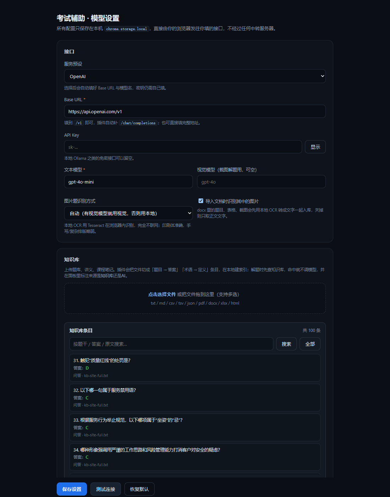

# 考试副驾 · exam-pilot

> 题库优先的浏览器考试辅助。先在你的知识库里找答案，找到了毫秒级直接给出；找不到才交给大模型推理。

Chrome MV3 扩展。识别网页上的考试题目 → 查本地知识库 → 命中就答，未命中再走 AI → 自动填涂，并标注每道题的答案来源。



---

## 为什么要「题库优先」

大多数考试辅助工具只会把每道题都丢给模型：

- 慢（每题几秒）
- 贵（每题都计费）
- 不稳（同一道题两次答案可能不同）

但如果题库已经收录了这道题，正确答案就在本地，根本不需要模型。所以这里的默认路径是：

```
页面题目 → 规范化 → 本地检索 → 命中 → 直接答（~10ms，零成本）
                            ↘ 未命中 → 模型推理（几秒）
```

面板上每题都会标明走了哪条路：`知识库 · 精确 · 8ms` / `AI 生成 · 3200ms`。

---

## 核心能力

| 能力 | 说明 |
|---|---|
| **知识库优先** | BM25 + 中文二元分词，内存索引，单题检索 ~1ms |
| **多路匹配** | 题干精确 → 同义问法索引 → 选项指纹 → 题干相似度兜底 |
| **选项乱序自适应** | 按选项**文字**映射答案，不依赖字母顺序 |
| **AI 兜底** | 知识库未覆盖时走模型，支持任意 OpenAI 兼容接口 |
| **图片题识别** | 本地 Tesseract OCR（离线免费）或视觉模型，可切换 |
| **docx 题库导入** | 正文与内嵌图片一并入库，图片内多题自动切分 |
| **模拟人工填涂** | 完整鼠标事件序列 + 移动轨迹，兼容"点一下就重渲染"的页面 |
| **跟随模式** | 自动作答当前题，不自动翻页 |
| **答题记录** | 自动写本地 JSONL，事后可核对该题走了库还是 AI |
| **多题型** | 单选 / 多选 / 判断 / 填空 / 简答 |

---

## 安装

1. 下载或 clone 本仓库
2. 打开 `chrome://extensions/`
3. 右上角开启「开发者模式」
4. 点「加载已解压的扩展程序」，选择仓库根目录下的 `extension/`（或先把源码同步过去，见下）

打包成 zip 安装包：

```bash
npm install
npm run pack          # 生成 dist/exam-helper-<版本>.zip
npm run update        # 打包 + 同步到 extension/ + 冒烟测试
```

---

## 使用

| 操作 | 说明 |
|---|---|
| `Alt+Shift+Q` | 开关解题面板 |
| `Alt+Shift+S` | 识别并解出本页全部题目 |
| `Alt+Shift+F` | 把已有答案填入页面 |

面板工具栏：

```
[识别本页] [自动连做] [撤销填涂] [识别图片题] [库体检] [导出] [清空]
```

- **识别本页**：抓取页面上所有题目
- **自动连做**：持续作答、填涂、翻页
- **识别图片题**：题目是 canvas 或大图时用
- **库体检**：逐题检查知识库匹配情况，红标会显示"库里最像的是哪一条"
- **导出**：把本页答案导成 Markdown

---

## 配置

设置页 → 模型配置：

```
服务预设      OpenAI / DeepSeek / Moonshot / 通义 / 智谱 / Ollama …
Base URL     https://api.openai.com/v1
API Key      sk-…
文本模型      gpt-4o-mini
视觉模型      gpt-4o              （可空，空则图片题走本地 OCR）

图片题识别方式
  ● 自动（有视觉模型就用视觉，否则用本地）
  ○ 本地 OCR（离线，不调 API）
  ○ 视觉模型（更准，需配视觉模型）
```

所有配置只存在本机 `chrome.storage.local`，请求直接从浏览器发往你填的接口。

---

## 知识库

支持格式：`txt / md / csv / tsv / json / html / pdf / docx / xlsx`

导入方式：拖进设置页的虚线框，或点击选择（可多选）。

### 它是怎么切分的

```
题库文件 → 切成「题目 → 答案」「术语 → 定义」「资料原文」条目 → 本地建索引
```

几条关键处理：

- **题目段落不合并**：一道题一条，否则搜关键词会命中整页
- **图片题单独切**：docx 里一张图若有 5 道题，OCR 后按题号切成 5 条
- **尾部噪音清洗**：`请选择一项`、`第 N 题` 之类会被剔除后再建 key
- **选项指纹**：选项文本集合一致的题视为同一道，题干措辞不同也能命中

### 看一眼库里有什么

设置页 → 知识库条目：

```
共 100 条
[按题干 / 答案 / 原文搜索…]  [搜索] [全部]

31. 触犯"质量红线"的处罚是？
    答案：D
    问答 · kb-site-full.txt
```

能搜、能翻页、能看每条的来源文件。**导入后建议先在这里核对一遍**。

---

## 图片题

两条路径：

**本地 OCR**（默认，离线）
- Tesseract.js（WASM）跑在扩展的 offscreen 页面里
- 内置 `chi_sim` + `eng` 语言包
- 实测单张识别 ~440ms，不联网、零成本
- 印刷体准确，手写/复杂排版弱

**视觉模型**（更准，需配置）
- 把图片直接交给多模态模型
- 复杂公式、手写、图表更强
- 需要 API，按量计费

docx 里的内嵌图片也会走同样的引擎，识别出的文字并入知识库。

---

## 开发与测试

```bash
npm run test:all      # 全部 e2e（会启动真实 Chrome 实例）
npm run test:e2e      # 基础识别与填充
npm run test:kb       # 知识库检索
npm run test:multiq   # 一页多题
npm run test:ocrlocal # 本地 OCR
npm run verify        # 静态检查 + 打包 + 全量题库校验
```

主要测试覆盖：

| 测试 | 内容 |
|---|---|
| `e2e` | 六种题型识别 + 填涂 |
| `e2e-kb` | 知识库命中与来源标注 |
| `e2e-realsite` | 真实 25 题整卷全流程 |
| `e2e-multiq` | 一页 6 题全部自动填涂 |
| `e2e-judgemulti` | 判断题/多选的边界写法 |
| `e2e-ocrlocal` | 本地 Tesseract 识别 |
| `e2e-docximg` | docx 内嵌图片 OCR 入库 |
| `e2e-ocrsplit` | 一张图 5 道题切成 5 条 |
| `e2e-mouse` | 鼠标事件序列与轨迹 |

实测基线：

```
100 题全量检索     100/100 精确命中，0 无结果
选项乱序 200 次    200/200 正确，100% 来自知识库
一页 6 题          识别 6/6，填涂 6/6，763ms
单题全程           识别 12ms + 解题 20ms + 填涂 17ms
本地 OCR           440ms/张
```

---

## 目录结构

```
manifest.json          MV3 清单
src/
  background.js        后台：检索、解题、缓存、消息路由
  content/             内容脚本：识别 / 填涂 / 面板 / 主流程
  lib/                 知识库 / 分词 / 切分 / 文件解析
  offscreen/           本地 OCR 容器
  options/             设置页
demo/                  测试用页面与题库
tools/                 e2e 测试与诊断脚本
vendor/                第三方库（mammoth / pdf.js / xlsx / tesseract）
```

---

## 已知限制

- **无法移动系统鼠标指针**：网页脚本没有这个权限。填涂能派发完整鼠标事件序列和移动轨迹，但事件里 `isTrusted` 仍是 `false`。需要真正可信事件只能用 `chrome.debugger` + CDP，代价是浏览器顶部常驻调试横幅。
- **跨域图片无法读取**：canvas 会被污染，这类图片题只能用整屏截图兜底。
- **本地 OCR 对手写和复杂排版较弱**：这类题建议切到视觉模型。
- **题库质量决定上限**：如果题库里同一道题有两条且答案矛盾，插件会拒绝直答（报冲突）而不是乱猜。

---

## 许可

仅供个人学习与研究使用。请遵守所在考试平台的规则。
