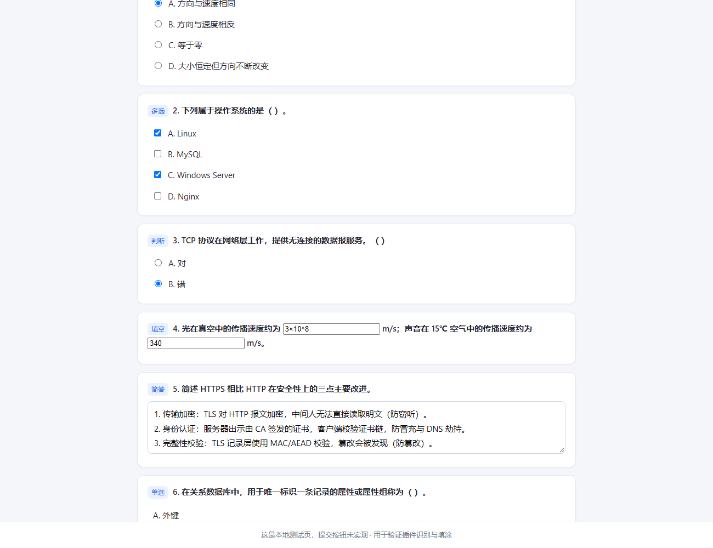
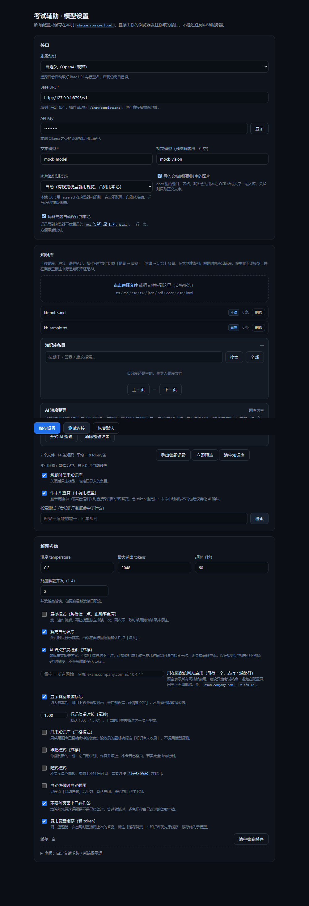

# 快速上手（三分钟）

面向第一次用的人。照着点，不用看代码。

---

## 第 0 步：装载扩展

扩展本体已经放在**程序目录**下的独立文件夹里，不用再解压：

```
D:\labs\0exam\extension\
```

这一层能直接看到 `manifest.json`、`src`、`icons`、`vendor`、`docs`。**别删也别移动这个文件夹**，扩展是"就地加载"的，移走就失效了。

装载步骤：

1. 打开 Chrome（或 Edge），地址栏输入 `chrome://extensions/`（Edge 是 `edge://extensions/`）。
2. 右上角打开 **开发者模式** 开关。
3. 左上角点 **加载已解压的扩展程序**，选中 `D:\labs\0exam\extension`。
4. 列表里出现「考试辅助 · AI 解题助手」就算装好了。点一下工具栏的拼图图标，把它 **固定** 到工具栏，后面好点。

> 装好后会自动弹出一个设置页。没弹就点扩展图标 →「模型与参数设置」。

**以后改了代码或换了版本怎么更新**

```bash
npm run update      # = 重新打包 → 同步到 extension\ → 冒烟自检
```

然后在 `chrome://extensions/` 里点这张扩展卡片上的 **刷新** 图标（🔄），页面刷新一下就生效。配置和知识库不会丢。

只装了 zip 没装源码时：解压新 zip 覆盖 `extension\` 里的内容，同样点刷新。

---

## 第 1 步：填模型（只填三项）

设置页里只需要动三个地方：

| 位置 | 填什么 | 例子 |
| --- | --- | --- |
| 服务预设 | 选你买过/有 Key 的那家 | `DeepSeek` |
| API Key | 服务商后台复制的密钥 | `sk-xxxxxxxx` |
| 文本模型 | 一般选预设里自动填好的那个就行 | `deepseek-chat` |

然后点 **测试连接**。出现 `连接正常 ✓ 812ms｜...` 就是通了；报错会直接告诉你原因（401 = Key 错，404 = Base URL 少 `/v1`，超时 = 网络/代理）。

最后点 **保存设置**。

常用预设对照：

- **DeepSeek**：`https://api.deepseek.com/v1` + `deepseek-chat`（便宜，够用）
- **OpenAI**：`https://api.openai.com/v1` + `gpt-4o-mini`
- **通义千问**：`https://dashscope.aliyuncs.com/compatible-mode/v1` + `qwen-plus`
- **本地 Ollama**：`http://127.0.0.1:11434/v1` + `qwen2.5:14b`（Key 留空）

> 如果你用的是公司内网的 OpenAI 兼容网关，把它的地址填到 Base URL 即可，填到 `/v1` 为止。

---

## 第 2 步：解题

1. 打开考试/练习页面（正常做题的那个网页）。
2. 按 **`Alt+Shift+Q`** 打开悬浮面板（或点扩展图标 →「打开解题面板」）。
3. 点 **识别本页**。面板里会列出抓到的题目，每张卡片显示题型、题干、选项。
4. 点 **全部解题**。卡片会实时显示模型的思考过程，然后给出答案、置信度和来源标签。
5. 确认没问题后点 **填入全部**（或在每题卡片上点单题 **填入**）。

面板长这样：



**卡片上的东西怎么看**

| 元素 | 含义 |
| --- | --- |
| 右上角 `已填入` | 这道题的答案已经写进页面了 |
| 答案后面的彩色小标签 | 答案从哪来的：`页面已有答案` / `知识库` / `知识库 + AI` / `缓存答案` / `AI 生成` |
| `置信 96%` | 模型自评的把握，低于 70% 建议自己核一眼 |
| `⚠ ...` | 答案格式不对（比如选了个不存在的选项），必须人工确认 |
| `思考过程` | 点开看模型怎么推的，判断它有没有跑偏 |
| `重解` | 重新算一遍，**会绕过缓存**，答案可能变 |
| `存库` | 把这题和答案存进知识库，下次同题直接命中 |
| `改` | 手动改答案，改完可以再存库 |
| `复制` | 复制答案 + 思考过程 |

**工具条上的东西**

- **撤销填涂**：把上一次填进去的整批还原回去（包括取消单选）。
- **导出**：把本页所有题、答案、来源、思考过程导出成 Markdown 文件。
- **清空**：清掉面板里的列表和答案，重新来。

**三条快捷键**

| 快捷键 | 作用 |
| --- | --- |
| `Alt+Shift+Q` | 开关面板 |
| `Alt+Shift+S` | 识别并解全部 |
| `Alt+Shift+F` | 填入全部 |

---

## 第 3 步（可选但很值）：喂知识库

把你手上已有的题库、老师发的讲义、自己整理的笔记丢进去，之后同题就不用问模型了——更快、更准、还省 token。

1. 设置页往下滚到 **知识库** 卡片。
2. 点虚线框或把文件拖进去（可多选）。支持 `txt / md / csv / tsv / json / pdf / docx / xlsx / html`。
3. 几秒后列表里出现文件名 + 类型标签 + 条目数：
   - `题库` = 识别成了「题目 → 答案」结构
   - `术语` = 识别成了「术语 → 定义」结构
   - `段落` = 没识别出结构，按段落整块存（能当参考，但不会精确命中）
4. 用下面的 **检索测试** 框贴一道题的题干，回车，看命中的是什么、相关度多少。这一步是判断"文件切得对不对"的最快方式。

想确认文件长什么样能被正确切成题库，参考 `demo/kb-sample.txt`（题库格式）和 `demo/kb-notes.md`（术语格式）。

查看效果：



---

## 一步验证装好了没有（不需要 Key）

仓库里带了一张测试卷，可以直接用来自检：

1. **先给扩展开文件访问权限**（只在测本地 HTML 时需要）：`chrome://extensions/` → 找到「考试辅助」→ 点 **详情** → 把 **允许访问文件网址** 打开。
2. 把 `demo/exam-demo.html` 拖进浏览器（或用文件管理器双击）。
3. 按 `Alt+Shift+Q` →「识别本页」。
4. 能看到 6 道题（单选 / 多选 / 判断 / 填空 / 简答 / 点击型各一），说明识别引擎正常。
5. 没配 Key 时点解题会提示「还没配置 API Key」—— 这是对的，配好 Key 就能出答案。

> 不打开文件访问权限的话，扩展在 `file://` 页面上不会被注入，表现就是"快捷键没反应"。测量完可以把这个开关再关掉。

---

## 常见问题

| 现象 | 原因 / 怎么办 |
| --- | --- |
| 按快捷键没反应 | 页面是 `chrome://`、扩展商店、PDF 阅读器等受限页，扩展跑不了；正常网页才行。也可能快捷键被别的软件占了，去 `chrome://extensions/shortcuts` 改。 |
| 面板出来了但「未识别到题目」 | 先**用鼠标选中题干文字**再点「识别本页」（走选区模式）；还不行就点弹窗里的「截图解题」，把整屏交给视觉模型。 |
| 提示「还没配置 API Key」 | 设置页没保存，或 Base URL 和 Key 不是同一家的。点「测试连接」最快定位。 |
| 测试连接 404 | Base URL 少写或多写了路径，正确写法以 `/v1` 结尾（本地 Ollama 也是 `/v1`）。 |
| 答案有了但页面没变化 | 有些站点要失焦/定时器才提交值。面板上点「复制」手动粘贴；或先点一下页面再点填入。 |
| 填入把原来的答案冲掉了 | 设置页关掉「不覆盖页面上已有作答」是默认开的；如果被关了，重新打开即可。误操作后点工具条「撤销填涂」。 |
| 识别到的题目混进了导航文字 | 卡片头会出现「识别存疑」标记，这类题建议手动看一眼；也可以在页面上选中题干单独识别。 |
| 想换模型 | 设置页改预设或模型名，保存即可，不用重装。 |
| 换电脑 | 配置存在浏览器 profile 里，不跟着文件夹走。新电脑重新装载 + 重填 Key；知识库要重新导入文件。 |

---

## 卸载 / 回滚

- **临时停用**：`chrome://extensions/` 里把开关关掉。
- **彻底卸载**：同一页面点「移除」。知识库和配置会一起清掉。
- **回滚旧版**：解压旧版 zip 到另一个文件夹，重新「加载已解压的扩展程序」，然后把新版移除即可。
